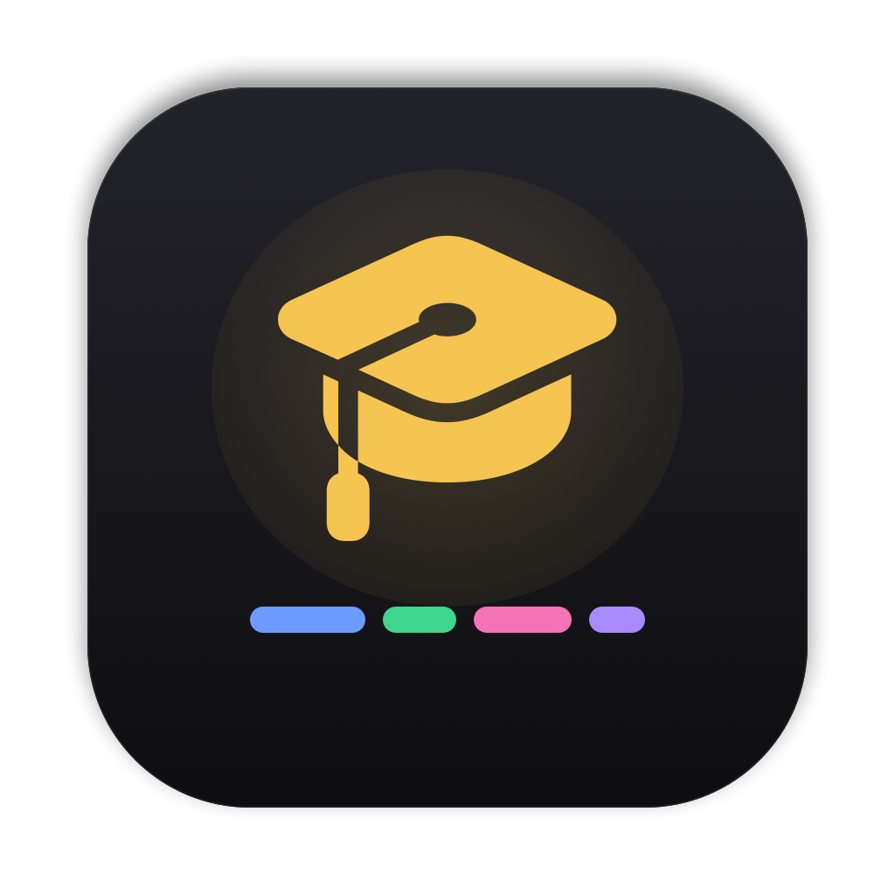

# University Portal

A native macOS app that brings Saarland University's **Moodle** and **CMS** (cms.sic.saarland) into one place: deadlines, announcements, course materials with a built-in PDF viewer, and your weekly schedule. Everything is stored on your Mac; the app talks only to Moodle and CMS.



## Features

- **Today**: what's due soon, today's and tomorrow's lectures, upcoming exams, and what's new since your last visit.
- **Deadlines** from Moodle, grouped by week and month, with mark-as-done. Submitted assignments are marked done automatically.
- **Announcements** from Moodle news forums and CMS course news in one feed, with a reader.
- **Materials** from Moodle and CMS by course and section; PDFs open in the app (with a dark-pages mode), other files in their default app.
- **Schedule**: a week grid of CMS calendar events and Moodle deadlines; hide categories you don't need (e.g. other people's tutorials).
- **Course pages**, a menu bar summary, and sync in the background (open at login).

## Install

Download `University-Portal-<version>.dmg` from [Releases](../../releases), open it and drag the app into Applications. The app isn't notarized, so macOS blocks it the first time: open it once, then go to **System Settings → Privacy & Security → Open Anyway**. The disk image's "Read Me First" walks through connecting Moodle and CMS.

Requires macOS 15 or newer (Apple silicon or Intel).

## How it works

| Source | Access |
| --- | --- |
| Moodle | The official mobile web service API with your app token. Connect once in Settings: Moodle's `moodlemobile://` redirect comes back to the app. Your university password is never stored. |
| CMS news and calendars | Public pages and `.ics` feeds. |
| CMS materials | Your CMS login (stored in the Keychain), with automatic re-login and at most one attempt per 15 minutes after a failure. |

Data lives in a local SQLite database (GRDB); secrets live in the Keychain. The full design and the verification log are in [the implementation plan](University%20Module%20%E2%80%94%20Implementation%20Plan.md).

## Build from source

Xcode 27 or newer.

```bash
cd UniversityKit && swift test        # 77 tests, against recorded fixtures
./Scripts/install.sh                  # build Release, install to /Applications
./Scripts/package.sh                  # build dist/University-Portal-<version>.dmg
```

Release builds are signed with a local certificate named "Conscious Dev"; change `CODE_SIGN_IDENTITY` in the project to use your own.

## Layout

```
App/                 SwiftUI app (views, theme, PDF viewer, menu bar)
UniversityKit/       Swift package: Moodle and CMS adapters, sync, store, Keychain
Config/              entitlements, Info.plist additions, icon, read-me for the disk image
Scripts/             install.sh, package.sh
```
